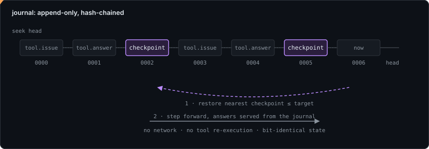

<div align="center">


# cindervm

A deterministic bytecode virtual machine for agent execution.
Bytecode is verified before it runs, the whole machine is a value you can
snapshot, and a run replays exactly from its journal.

</div>

---

## Contents

- [What this is](#what-this-is)
- [Why bytecode instead of a coroutine](#why-bytecode-instead-of-a-coroutine)
- [The three invariants](#the-three-invariants)
- [Toolchain walkthrough](#toolchain-walkthrough)
- [The instruction set](#the-instruction-set)
- [The verifier](#the-verifier)
- [Continuations and replay](#continuations-and-replay)
- [Building from source](#building-from-source)
- [Repository layout](#repository-layout)
- [Stability](#stability)
- [License](#license)

---

## What this is

An agent run is long-lived, effectful, and resumable. Modelled as a host
coroutine, its suspended state is a compiler-generated struct with no
serializable form: you cannot write it to disk, inspect it, or resume it in a
different process.

`cindervm` models the run as bytecode on a machine built for it. The library
crate (`cindervm`) holds the machine and its toolchain; three binaries drive it:

| Binary       | Role                                                             |
| ------------ | --------------------------------------------------------------- |
| `cinderc`    | Assemble `.cdx` to a verified `.cdxb` image, disassemble, run.   |
| `cinder`     | Print the version, explain a diagnostic code, run an image.      |
| `cinder-fuzz`| Mutation-fuzz the verifier and interpreter against each other.   |

The crate has no dependencies outside `core`, `alloc`, and `std`. The hash
(`hash.rs`), the heap arena (`heap.rs`), and the argument parsing in the
binaries are all written in-crate, because this is a trust boundary and every
dependency is code you would also be trusting. `unsafe` is denied crate-wide
(`#![deny(unsafe_code)]`).

## Why bytecode instead of a coroutine

Three designs were considered and set aside:

**Host coroutines** (`async fn`, `async def`). Suspension points are implicit
and the suspended state has no stable representation. Good for I/O concurrency,
wrong for a run you want to move or persist.

**Replay-based durable execution.** Recovery re-runs the whole program and
short-circuits completed calls from a log, which makes one unlogged source of
non-determinism enough to diverge. `cindervm` restores state directly rather
than re-deriving it, and every source of non-determinism (`NOW`, `RAND`, tool
answers) is an instruction that reads from the journal.

**Interpreting a live object graph.** Serialization becomes a graph walk with
identity preservation. A flat operand stack over a flat heap arena of tagged
values serializes as a copy of two arrays plus a relocation pass.

The VM approach costs an assembler and a verifier. It buys a machine state that
is already a byte string.

## The three invariants

Most of the codebase falls out of three rules, stated verbatim at the top of
`src/lib.rs`:

1. **The interpreter performs no I/O.** `interp::Vm::step` is a pure function of
   `(image, state, answer)`. When it needs an effect it returns a `trap::Trap`
   and stops; the host answers with a `trap::Answer`. Replay is exact because
   `replay::Host` serves answers from a journal and the interpreter cannot tell
   the difference: there was never a code path that touched the network.
2. **Every value is `Copy`, tagged, and pointer-free.** `value::Value` is 16
   bytes with an explicit tag byte and no `Drop`. Larger payloads live in the
   arena behind a `value::Handle`, an arena-relative offset. Snapshot is two
   copies and a hash; restore relocates by arithmetic.
3. **Verification is a precondition, not a mode.** An `image::Image` cannot be
   constructed except through `verify::admit`. By the time the interpreter sees
   an image, stack depth, operand types, pending-value liveness, branch targets,
   metering on back-edges, and fork balance have been proven. So `interp`
   carries no `pc` bounds check and no stack-depth check.

## Toolchain walkthrough

`.cdx` is a macro assembler for the bytecode, meant for tests and examples; the
production path is `asm::Builder` driven by a higher-level frontend. A minimal
program and the toolchain applied to it:

```asm
        .isa      cdx/4
        .image    "triage"
        .fn       main() -> i32
        .maxstack 1
main:
        ldi       0
        ret
```

```sh
$ cinderc build triage.cdx -o triage.cdxb
wrote triage.cdxb (N bytes, checksum 0x...)

$ cinderc dis triage.cdxb          # disassemble the sealed image
$ cinderc run triage.cdxb --trace  # run, tracing traps and the halt code
$ cinder explain E_PENDING_ESCAPE  # look up a diagnostic code
```

`cinderc build` assembles, then calls `verify::admit`, then writes the sealed
`.cdxb`. `cinderc run` reads an image, constructs a `Vm` with default limits,
and drives the `step` loop, answering each trap. `cinder run` delegates to
`cinderc run`; `cinder explain <CODE>` prints the blurb and phase for a
diagnostic code, or lists every known code when the argument is unrecognised.

<div align="center">

</div>

## The instruction set

`cdx/4`, defined once in `src/isa.rs` as a `const` table (opcode, operand
shape, stack effect, type rule, effect class). The assembler mnemonics, the
disassembler, and the verifier's transfer functions all read from that single
table, and `cinderc --emit-isa-md` renders it. Encoding is fixed 4-byte
(`INSN_LEN = 4`) with a wide prefix (`0xFF`) promoting the operand field for
large constant pools.

The opcode classes, from the ISA table:

| Class       | Purpose                                                         |
| ----------- | --------------------------------------------------------------- |
| Stack       | `LDC` `LDI` `DUP` `DUPN` `DROP` `SWAP` `ROT` and local slots.    |
| Data        | `PACK` `UNPACK` `IDX` `LEN` `CAT` `FMT`; heap-allocating.        |
| Arithmetic  | Wrapping i64 only. No floats, which are not portable-determin.   |
| Control     | `BR` `BRZ` `BRNZ` `CALL` `RET` `TAIL` `SWITCH`; function-local.  |
| Effects     | `CALLTOOL` `AWAIT` `POLL` `CANCEL`; the only suspending ops.     |
| Durability  | `CHECKPOINT` `YIELD_CTX` `RESUME`; snapshot boundaries.          |
| Metering    | `RESERVE` `RELEASE` `SPEND`; two-phase budgeting.                |
| Context     | `CTXPUSH` `CTXPOP` and friends; conversation context as a ring.  |

Floats, indirect branches, and host pointers are deliberately absent: each
would break serializability or the verifier's static control-flow graph.

## The verifier

`src/verify.rs` is a JVM-style verifier: abstract interpretation over the
control-flow graph (`src/cfg.rs`), iterated to a fixpoint, with merge points
unifying the abstract frames. The type lattice is
`Bottom ⊑ {Int, Str, Bytes, List, Handle, Pending} ⊑ Top`, with `Top` illegal
at any use site (`isa::Ty`). It runs at load and proves, among other properties:

- stack depth at every instruction is single-valued and within `maxstack`;
- every operand has a type the instruction accepts;
- no `Pending` value is live at a return or a snapshot boundary, so no snapshot
  can capture a half-issued effect nobody is awaiting;
- branch targets land on real instructions in the same function;
- every cycle in the CFG contains a metering instruction, so a runaway loop
  burns budget rather than wall-clock.

Diagnostics carry source spans from the assembler (`src/diag.rs`), so a verify
failure on hand-written `.cdx` reads like a compiler error with a code such as
`E_PENDING_ESCAPE`, which `cinder explain` can describe.

## Continuations and replay

A snapshot is the machine flattened to a byte string: a header binding it to an
image hash, the call frames, the operand slots, the heap arena, the context
ring, and the budget ledger, sealed with a content hash (`src/cont.rs`).
`cont::restore` validates the hash, the image binding, and every handle's extent
before it reconstructs, so a snapshot from a different image fails with an image
mismatch rather than a wild jump.

The journal (`src/journal.rs`) is append-only and hash-chained: each record
commits to the previous record's hash, so a truncated or edited journal is
detectable. `replay::Host` (`src/replay.rs`) serves the interpreter from that
journal instead of from a live host; if the interpreter asks for something the
journal does not have next, that is a divergence error naming the record.

<div align="center">

</div>

## Building from source

Requires Rust (pinned in `rust-toolchain.toml`). The `Makefile` is the source of
truth for what CI runs; `.github/workflows/ci.yml` calls the same targets.

```sh
cargo build --release            # library + cinderc, cinder, cinder-fuzz
cargo test                       # unit tests, including the invariant tests
cargo clippy --all-targets       # lints configured in Cargo.toml
cargo run --bin cinderc -- --emit-isa-md   # regenerate the ISA reference
```

The release profile uses fat LTO, a single codegen unit, `panic = "abort"`, and
stripped symbols (`Cargo.toml`). The `fuzz` profile turns on debug assertions
and overflow checks so the fuzzer catches arithmetic and arena mistakes.

## Repository layout

The Rust core is intentionally flat; module boundaries follow the machine's
structure.

```
cindervm/
├── src/
│   ├── lib.rs        crate root, the three invariants, #![deny(unsafe_code)]
│   ├── isa.rs        opcode table, encoding, stack effects, type rules
│   ├── value.rs      tagged 16-byte Value, arena handles, coercions
│   ├── lex.rs        .cdx tokenizer with span tracking
│   ├── asm.rs        parser, symbol resolution, fixups, encoder
│   ├── image.rs      .cdxb container: sections, header, sealing
│   ├── cfg.rs        basic blocks, dominators, loop headers
│   ├── verify.rs     abstract interpreter, type lattice, CFG fixpoint
│   ├── interp.rs     the dispatch loop and instruction semantics
│   ├── frame.rs      call frames and operand stack windows
│   ├── heap.rs       bump arena, handle validation
│   ├── cont.rs       snapshot / restore, relocation, validation
│   ├── journal.rs    hash-chained record log and cursor
│   ├── replay.rs     journal-backed host, divergence detection
│   ├── budget.rs     two-phase reservation ledger
│   ├── ctx.rs        context ring, windowing, token accounting
│   ├── trap.rs       the interpreter/host boundary type
│   ├── wire.rs       frame protocol codec (behind the `wire` feature)
│   ├── diag.rs       spans, stable error codes, rendered diagnostics
│   ├── disas.rs      disassembler and `cinderc dis` output
│   ├── hash.rs       in-crate content hashing
│   └── bin/
│       ├── cinderc.rs     assembler / runner CLI
│       ├── cinder.rs      version / explain / run
│       └── cinder_fuzz.rs mutation fuzzer
└── docs/
    ├── internal-contract.md   frozen inter-module interface
    └── assets/                the three SVG identity assets
```

## Stability

`0.x`: the library API is not stable. The `.cdxb` container carries a format
version and the ISA is versioned separately (`cdx/4`, `ISA_VERSION = 4`); adding
opcodes bumps the ISA minor, changing the meaning of one bumps the ISA version.
`CHANGELOG.md` tracks changes.

## License

Apache-2.0. See [LICENSE](LICENSE).
